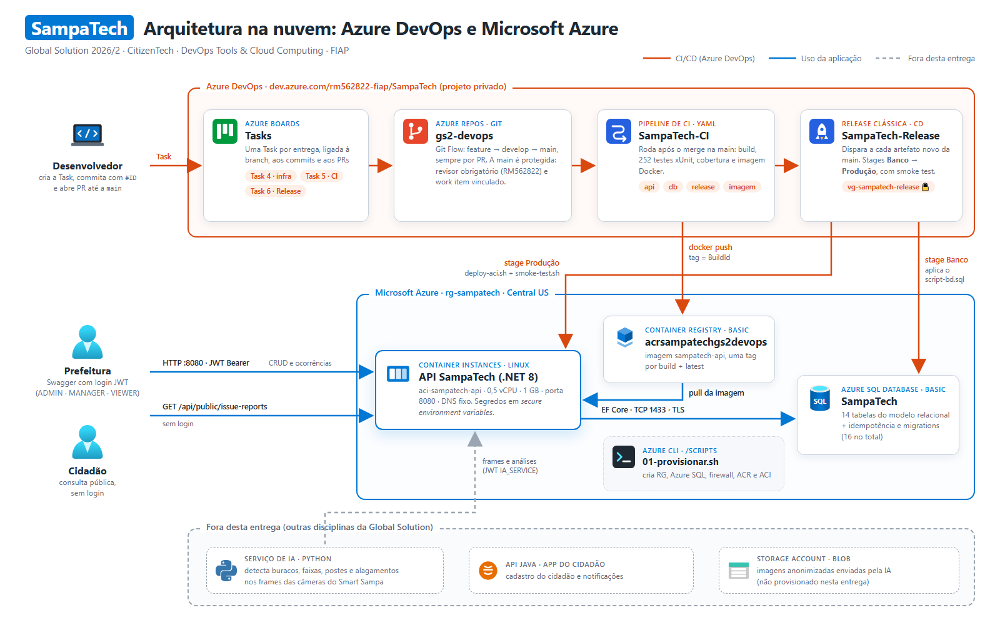

# SampaTech: DevOps Tools & Cloud Computing

Global Solution 2026/2 (FIAP) · tema **CitizenTech** · disciplina *DevOps Tools & Cloud Computing*.

O **SampaTech** reaproveita as câmeras do **Smart Sampa** para a zeladoria urbana. A IA analisa frames das
câmeras e detecta buracos, faixas apagadas, postes apagados e vias alagadas. Cada detecção vira uma ocorrência
priorizada, a prefeitura atribui uma equipe e o cidadão acompanha o status.

Nesta disciplina, a **API .NET** e o **banco** rodam na Azure, com o ciclo inteiro automatizado no Azure DevOps:
Task no Boards → código no Repos → CI em YAML → Release com deploy no Azure Container Instances.

| | |
|---|---|
| Projeto no Azure DevOps | `https://dev.azure.com/rm562822-fiap/SampaTech` (privado) |
| API publicada (Swagger) | `http://sampatech-gs2devops.centralus.azurecontainer.io:8080/swagger` |
| Health check | `http://sampatech-gs2devops.centralus.azurecontainer.io:8080/health` |

## Arquitetura macro



O desenho é gerado a partir de [`docs/arquitetura-azure.html`](docs/arquitetura-azure.html).

**Legenda**

| Traço | Significado |
|---|---|
| Laranja contínuo | Fluxo de CI/CD no Azure DevOps (Task, código, build, imagem e deploy) |
| Azul contínuo | Uso da aplicação em produção (quem chama a API e o que a API acessa) |
| Cinza tracejado | Partes do projeto do grupo que **não** fazem parte desta entrega |

**O que roda na Azure** (resource group `rg-sampatech`, região Central US)

| Recurso | Nome | Para que serve |
|---|---|---|
| Azure SQL Database (Basic) | servidor `sql-sampatech-gs2devops`, banco `SampaTech` | Banco relacional da API: 14 tabelas do modelo, mais a de idempotência e o histórico das migrations |
| Azure Container Registry (Basic) | `acrsampatechgs2devops` | Guarda a imagem `sampatech-api`, com uma tag por build (`BuildId`) e `latest` |
| Azure Container Instances (Linux) | `aci-sampatech-api` | Executa a API .NET 8 na porta 8080, com DNS fixo `sampatech-gs2devops` |

**O que fica fora desta entrega:** o serviço de IA (Python), a API Java do app do cidadão e o Storage Account
das imagens são de outras disciplinas da Global Solution e aparecem tracejados no desenho.

## Estrutura do repositório

```
gs2-devops/
├── azure-pipeline.yml          pipeline de CI (YAML)
├── dockerfiles/
│   ├── Dockerfile              imagem da API (multi-stage, usuário sem privilégio, porta 8080)
│   └── Dockerfile.dockerignore o que não entra na imagem
├── scripts/
│   ├── 00-verificar-assinatura.sh  confere assinatura, regiões permitidas e providers (só lê)
│   ├── 01-provisionar.sh           cria toda a infraestrutura com Azure CLI
│   ├── 99-apagar-recursos.sh       apaga o resource group (pede confirmação)
│   ├── _comum.sh                   funções e nomes compartilhados
│   ├── .env.example                modelo do .env (o .env real não vai para o Git)
│   ├── script-bd.sql               DDL do banco (idempotente)
│   └── release/
│       ├── deploy-aci.sh           deploy no ACI, usado pela Release
│       └── smoke-test.sh           teste depois do deploy, usado pela Release
├── docs/                       desenho da arquitetura
└── gs2-dotnet/                 código da API .NET 8 (Clean Architecture) e testes xUnit
```

## Infraestrutura com Azure CLI

Os scripts ficam em [`scripts/`](scripts) e podem rodar mais de uma vez: o que já existe é mantido e só o que
falta é criado.

```bash
cp scripts/.env.example scripts/.env
```

Preencha o `scripts/.env` (região, assinatura, sufixo dos nomes e usuário e senha do SQL) e rode, no Git Bash:

```bash
az login
```

```bash
bash scripts/00-verificar-assinatura.sh
```

```bash
bash scripts/01-provisionar.sh
```

O `01-provisionar.sh` cria, nesta ordem: registro dos providers, resource group, servidor Azure SQL (TLS 1.2),
regras de firewall (serviços da Azure e o IP de quem rodou), banco Basic, ACR Basic e ACI com uma imagem
provisória. As tabelas não são criadas aqui: quem aplica o `script-bd.sql` é a Release, antes de cada deploy.

Para apagar tudo no fim do projeto:

```bash
bash scripts/99-apagar-recursos.sh
```

## Boards e Repos

- **Boards (processo Agile):** cada entrega é uma Task, que vai de `Active` para `Closed` quando a entrega é
  validada.

  | Task | Entrega |
  |---|---|
  | 4 | Provisionar infraestrutura Azure com scripts CLI |
  | 5 | Pipeline de CI em YAML com testes e imagem no ACR |
  | 6 | Release clássica com deploy no ACI e smoke test |

- **Repos (Git Flow):** cada Task tem uma branch `feature/*`. O código vai para a `develop` e depois para a
  `main`, sempre por Pull Request com merge sem fast-forward.
- **Vínculo com a Task:** os commits levam `#ID` na mensagem (ex.: `feat(release): add post-deploy smoke test #6`),
  e a branch e os PRs são ligados à Task. Assim a Task mostra tudo o que foi feito para ela.
- **Branch `main` protegida** (branch policies):
  - mínimo de 1 revisor, com o RM562822 como revisor padrão obrigatório;
  - work item vinculado obrigatório;
  - comentários do PR resolvidos antes do merge;
  - com as policies ativas, ninguém faz push direto na `main`: tudo chega por PR.
- **Branch `develop`:** work item vinculado obrigatório nos PRs.

## Pipeline de CI

Arquivo [`azure-pipeline.yml`](azure-pipeline.yml), pipeline **SampaTech-CI**.

- **Quando roda:** só depois de um merge na `main` (`trigger: main` e `pr: none`). Como a `main` é protegida,
  todo commit nela vem de um PR aprovado.
- **Agente:** `ubuntu-24.04`, hospedado pela Microsoft.

| Stage | O que faz |
|---|---|
| **Build e testes** | Instala o .NET da versão do `global.json`, restaura e compila. Roda os **221 testes de unidade** e os **31 de integração** (xUnit, com um SQL Server real em container via Testcontainers). Publica os resultados na aba *Tests* e a cobertura na aba *Code Coverage*. Confere se o `script-bd.sql` bate com as migrations do código. Gera o pacote da API. |
| **Imagem Docker no ACR** | Faz o build do `dockerfiles/Dockerfile` e envia a imagem ao ACR com a tag `$(Build.BuildId)` e `latest`. |

**Artefatos publicados**

| Artefato | Conteúdo | Usado por |
|---|---|---|
| `api` | Pacote da API (`dotnet publish`) | Registro do build |
| `db` | `script-bd.sql` | Release, stage Banco |
| `release` | `deploy-aci.sh` e `smoke-test.sh` | Release, stage Produção |
| `imagem` | `imagem.txt` com a tag exata, ex.: `sampatech-api:42` | Release, stage Produção |
| `Code Coverage Report_<id>` | Relatório de cobertura | Aba *Code Coverage* |

**Variáveis do pipeline:** `buildConfiguration`, `appDir`, `testResultsDir`, `acrServiceConnection`,
`imageRepository`, `dockerfilePath` e `imageTag`. O acesso ao ACR usa a service connection `sc-acr-sampatech`,
com *workload identity federation*, sem senha guardada.

## Release (CD)

Release clássica **SampaTech-Release**.

- **Gatilho:** *continuous deployment* a cada artefato novo do SampaTech-CI vindo da branch `main`.
- **Acesso à Azure:** service connection `sc-azure-sampatech`, com permissão só no resource group `rg-sampatech`
  (menor privilégio).

| Stage | Agente | Tarefas |
|---|---|---|
| **Banco (Azure SQL)** | `windows-latest` | *Azure SQL Database deployment*: aplica o `script-bd.sql` no banco `SampaTech`. O script é idempotente: cria só o que falta e nunca apaga dados. |
| **Produção (ACI)** | `ubuntu-24.04` | **Deploy no ACI** (Azure CLI): roda o `deploy-aci.sh`. **Smoke test** (Bash): roda o `smoke-test.sh`. Começa só depois que o Banco termina com sucesso. |

**O que o `deploy-aci.sh` faz**

1. Confere todas as variáveis antes de mexer no container. Se uma estiver vazia, ou chegar como o texto literal
   `$(NOME)` (segredo não mapeado), a Release para e o container anterior continua no ar.
2. Lê a tag do artefato `imagem` e confere se a imagem existe no ACR.
3. Lê a senha do ACR na hora do deploy e a esconde do log com `##vso[task.setsecret]`.
4. Monta a connection string com as variáveis do Variable Group.
5. Recria o ACI com a nova imagem, na porta 8080, com o mesmo DNS.

**O que o `smoke-test.sh` confere**

| Endpoint | Esperado | Prova que |
|---|---|---|
| `/health/live` | 200 | O processo da API subiu |
| `/health` | 200 | A API conecta no Azure SQL (responde 503 se o banco cair) |
| `/swagger/index.html` | 200 | A documentação está publicada |

Cada endpoint é testado até 36 vezes, com 5 segundos de intervalo. Se algum falhar, a Release fica vermelha
com a causa no log.

## Variáveis e segredos

Nenhuma senha, chave ou connection string fica no código. A Release usa o Variable Group
**`vg-sampatech-release`** (*Pipelines › Library*):

| Variável | Tipo |
|---|---|
| `AZ_RESOURCE_GROUP`, `ACR_NAME`, `ACI_NAME`, `ACI_DNS_LABEL` | comum |
| `SQL_SERVER_FQDN`, `SQL_DATABASE`, `SQL_ADMIN_USER`, `AUTH_ADMIN_USERNAME` | comum |
| `SQL_ADMIN_PASSWORD` | 🔒 secreta |
| `JWT_KEY` | 🔒 secreta |
| `AUTH_ADMIN_PASSWORD_HASH` | 🔒 secreta (hash da senha; a senha nunca é guardada) |

- As variáveis secretas não chegam sozinhas aos scripts. Elas são **mapeadas uma a uma** nas *Environment
  Variables* da tarefa de deploy.
- No ACI, os segredos vão como ***secure environment variables***: nem o portal nem o `az container show` mostram
  o valor.
- Nos scripts de provisionamento, a senha do SQL fica no `scripts/.env`, que está no `.gitignore`.

## Banco de dados

O DDL está em [`scripts/script-bd.sql`](scripts/script-bd.sql), gerado das migrations do EF Core com
`dotnet ef migrations script --idempotent`. O CI falha se o arquivo ficar diferente das migrations.

| Grupo | Tabelas |
|---|---|
| Cadastros | `MONITORING_POINT`, `CAMERA`, `CAPTURE_SCHEDULE`, `ISSUE_TYPE`, `MUNICIPAL_AGENCY`, `TEAM`, `TRIGGER_EVENT` |
| Fluxo da IA | `CAPTURE`, `IMAGE`, `AI_ANALYSIS`, `AI_DETECTION` |
| Ocorrências | `ISSUE_REPORT`, `ISSUE_HISTORY`, `ISSUE_ASSIGNMENT` |
| Controle | `IDEMPOTENCY_RECORD`, `__EFMigrationsHistory` |

## Como usar a API publicada

1. Abra o Swagger: `http://sampatech-gs2devops.centralus.azurecontainer.io:8080/swagger`.
2. Faça login em `POST /api/auth/login` com o usuário administrador.
3. Copie o `accessToken` e cole no botão **Authorize**.
4. Use as rotas de CRUD (por exemplo, `/api/municipal-agencies` e `/api/teams`).

Sem login, só ficam abertos o `/health`, o `/health/live` e a consulta pública `GET /api/public/issue-reports`.

## Rodar localmente

**Pré-requisitos:** .NET SDK 8 e Docker.

```bash
cd gs2-dotnet
```

```bash
cp .env.example .env
```

Preencha `MSSQL_SA_PASSWORD` no `.env` e suba o SQL Server:

```bash
docker compose up -d
```

Configure os segredos locais no *user-secrets* (o formato está em
[`gs2-dotnet/src/SampaTech.Api/appsettings.example.json`](gs2-dotnet/src/SampaTech.Api/appsettings.example.json)),
crie as tabelas e suba a API:

```bash
dotnet tool restore && dotnet ef database update --project src/SampaTech.Infrastructure --startup-project src/SampaTech.Api
```

```bash
dotnet run --project src/SampaTech.Api
```

Para rodar os testes (precisa do Docker ligado):

```bash
dotnet test SampaTech.sln
```

Para testar a imagem como ela roda na Azure (na raiz do repositório):

```bash
docker build -f dockerfiles/Dockerfile -t sampatech-api:local gs2-dotnet
```

## Integrantes

| Nome | RM | Turma |
|---|---|---|
| Ana Carolina Pereira Fontes | RM562145 | 2TDSPV |
| João Victor Nascimento Adão | RM563409 | 2TDSPX |
| Johnny Dias Mathias Junior | RM566516 | 2TDSPX |
| Luisa Ganasevici de Abreu | RM563403 | 2TDSPV |
| Matheus Moya de Oliveira | RM562822 | 2TDSPV |
